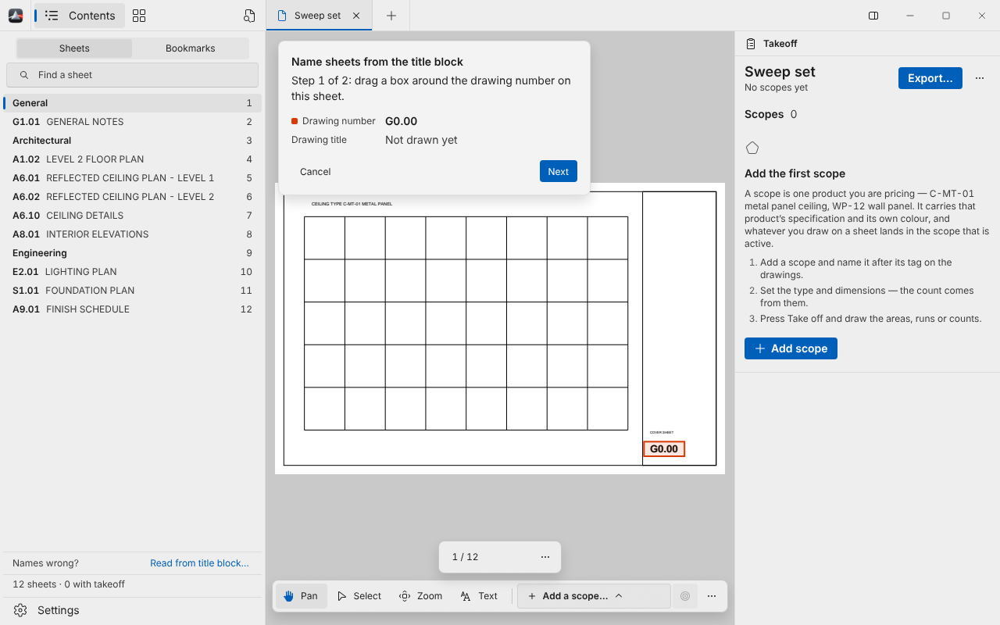
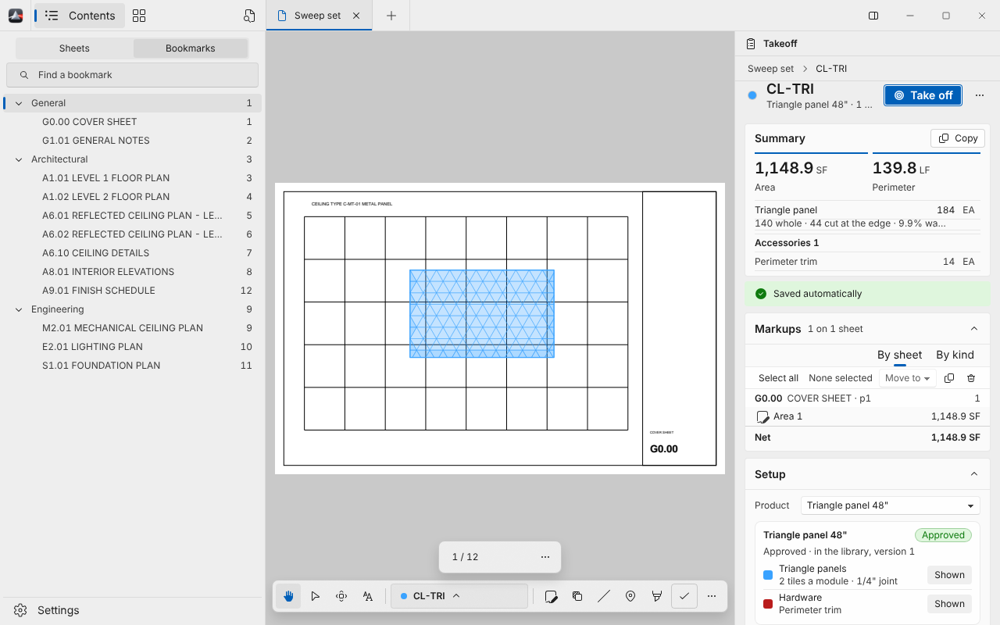
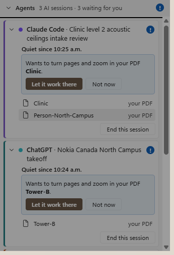
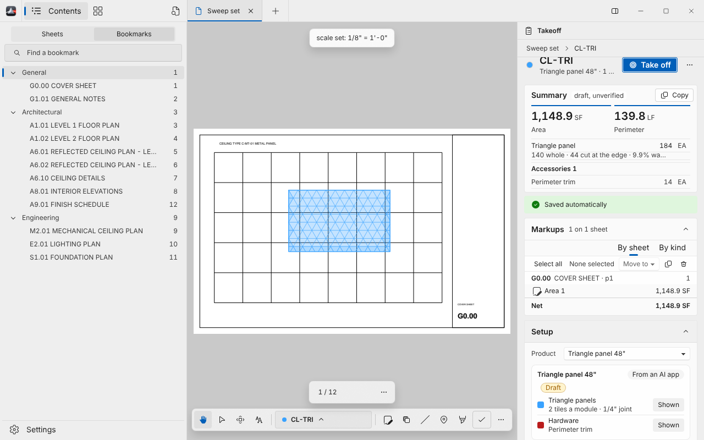

# REDBEAM beginner's guide

REDBEAM is Maxxit's takeoff tool. It is a PDF viewer, like Bluebeam, that measures ceilings and walls and counts the product in them: panels, planks, baffles, trim and hardware. Everything you do is saved inside the PDF itself, so there is no project to set up and nothing else to keep track of.

You can do a takeoff by hand, or ask ChatGPT (or Claude) to do it for you inside REDBEAM while you watch and approve. This guide covers both. It was written for REDBEAM 0.3.93 (November 2026).

---

## 1. Getting REDBEAM

### Option A: the installer (most people)

1. Go to the [latest release](https://github.com/aaronmcelwee/redbeam/releases/latest) and download **REDBEAM_x.x.x_x64-setup.exe** (use the **arm64** file only on a Snapdragon / ARM laptop).
2. Run it. REDBEAM is not code-signed, so Windows shows a blue "Windows protected your PC" box. Click **More info**, then **Run anyway**. You only see this once.
3. The installer adds REDBEAM to the Start menu and to **Open with** for PDFs. To make it your default PDF viewer, use **Make default…** on the start screen or **Settings › About › Default PDF viewer**. Bluebeam stays the default until you choose otherwise.

### Option B: the portable zip (if the installer is blocked or fails)

Some PCs refuse the installer (for example "Windows cannot access the specified device, path, or file"). The portable copy needs no install and no admin rights.

1. Download the [latest portable zip](https://redbeam-updates.trackchairking.workers.dev/files/REDBEAM_latest_x64_portable.zip).
2. **Before you unzip it**, right-click the zip, choose **Properties**, tick **Unblock** at the bottom, and click OK. (Skipping this can make Windows block the app inside.)
3. Unzip it into Documents or onto your Desktop (not into Downloads or a temp folder), and double-click **REDBEAM.exe**. If SmartScreen appears, click **More info › Run anyway**.

The portable copy does everything the installed one does, except it is not in the Start menu or in Open with. If your PC is missing Microsoft Edge WebView2, REDBEAM says so and offers Microsoft's download page.

### Updates

REDBEAM checks for new versions by itself. When one is ready, an update bar appears with **Download and install** (or **Download the new zip** for the portable copy), then **Restart now**. You can also check any time in **Settings › About › Check for updates**. After an update, **What's new** lists what changed; you can reopen it from Settings › About.

---

## 2. Doing a takeoff by hand

### The screen

- **Left:** the sheet list (**Contents**), with Thumbnails and Search tabs at the top.
- **Middle:** the drawing, with the toolbar along the bottom.
- **Right:** the **Takeoff** panel: your scopes, their quantities and their markups.
- **Top:** one tab per open PDF, like Bluebeam.

### Open a PDF

- Use **Open a PDF** on the start screen, **Ctrl+O**, drag a PDF onto the window, or right-click a PDF in File Explorer and choose **Open with › REDBEAM**.
- Each PDF opens in its own tab. **Ctrl+Tab** switches tabs, **Ctrl+W** closes one, **Ctrl+Shift+T** reopens the last one you closed.
- Big sets are fine. There is no size limit: 1,000+ sheet, multi-GB sets open in seconds.

### Get around the set

- Click a sheet in the Contents list, or type in **Find a sheet**. **Left / Right arrow** (or PgUp / PgDn) steps through sheets.
- Scroll to zoom and drag to pan (the **Pan** tool, **H**). **Z** zooms to a box you drag.
- Links on the drawings (detail bubbles, sheet numbers) work: click to jump, **Alt+Left** to come back.
- If the PDF has bookmarks, switch the list from **Sheets** to **Bookmarks**.
- **Ctrl+K** opens the command palette, which can find any command, sheet or scope by typing.

### Fix the sheet names (if needed)

If the sheet list shows "Page 14" or the same contract number on every sheet, click **Read from title block…** under the list. Drag a box around the **drawing number** on one sheet, then around the **drawing title**. REDBEAM reads the same two spots on every sheet and names them all. The names are saved in the PDF, and Bluebeam shows them as bookmarks too.

### Set the scale (do this first on every sheet you measure)

Markups on a sheet with no scale count nothing, and the sheet list shows **no scale** beside it.

- Click the scale button at the right end of the toolbar (it says **Unset** until a scale is set). Pick a common scale (1/8" = 1'-0", 1/4" = 1'-0", 1:50, 1:100) or open the full list.
- If you don't trust the printed scale, choose **Calibrate from the drawing** (or press **K**) and click two ends of a dimension you know.
- For many sheets at once, choose **Set scale for a range of sheets…**, or Ctrl+click several sheets in the list, right-click, and set one scale for all of them.

### Scopes: one per product you are pricing

A **scope** is one product, such as "CL03 Acoustic ceiling panels" or "CL02 Wood baffles". It has its own colour, its own product details and its own quantities. Whatever you draw goes into the scope that is active.

1. In the Takeoff panel, click **Add scope** and name it after its tag on the drawings.
2. Open **Setup** and pick the **Product** (panels, planks, baffles, cassettes, linear parts and so on). Fill in its sizes. The count comes from them.
3. Click **Take off**, then draw.

The **Summary** card at the top shows area, perimeter or length, and the part counts. **Copy** puts it on the clipboard as a two-column table, ready to paste into Excel.

### Drawing tools

| Tool | Key | How to use it |
|---|---|---|
| **Area** | A | Click the corners, or drag a rectangle. Enter finishes. |
| **Cutout** | X | Draw inside an area to take out a hole (a bulkhead, an atrium, a column). |
| **Linear** | L | Click along a run (trim, a wall, a light cove). Enter finishes. |
| **Count** | C | One click per item (lights, diffusers, sprinklers). |
| **Select** | V | Click a markup, or drag a box around several. Delete removes them; Ctrl+D duplicates. |
| **Dimension** | D | Measure one length off the sheet without adding to a scope. |
| **Text** | T | Drag a box around text, then Ctrl+C to copy it (great for RFIs). |
| **Direction / Origin** | O for Origin | Set which way panels or baffles run, and where the pattern starts. |

Points snap to the drawing's lines; hold **Alt** to place a point exactly where the cursor is. **Esc** cancels, **Ctrl+Z** undoes. Right-click a markup for more (Copy markup, Start the pattern here, and so on).

### Saving: the PDF is the record

- REDBEAM **saves your takeoff into the PDF automatically** a few seconds after each change. The Takeoff panel says **Saved automatically**. There is no Save button to remember.
- The same PDF opens in Bluebeam with your areas and lengths as normal Bluebeam markups, and Bluebeam edits come back into REDBEAM. Merging, inserting or reordering pages in Bluebeam takes the takeoff along with each sheet.
- Areas and lengths someone already drew in Bluebeam come in **dashed and pending**. They count toward nothing until you accept them: give one a scope, or use **Accept imported markups…** in Ctrl+K.
- If REDBEAM can't write into the PDF (it is open in Bluebeam, still syncing, or someone else saved first), it never throws your work away. It offers **Save a copy…** instead.
- **Client tender file?** Use **Save a copy with the takeoff…** (Ctrl+K) and work on the copy, so the original stays as it came.

### Reuse a takeoff

- **Copy / paste markups between PDFs:** select markups, Ctrl+C, switch to the other PDF's tab, Ctrl+V. They land in the same spot at real size, in the scope with the same name (created if it is missing).
- **Next bidding round:** open the new set and use **Start from another PDF's takeoff…** (Ctrl+K). Scopes come over, and markups land on matching sheets. Anything that could not be placed is counted so you know what to redraw.
- **Scopes only:** **Import scopes from another PDF…** brings the scopes and their product setup without the markups.

### Export the estimate

Click **Export…** at the top of the Takeoff panel. Fill in the cover (project, estimate, subtitle), untick any scope you want to leave out, and click **Save PDF**. The estimate PDF has a cover with a key plan, a quantities page, and a picture of every takeoff area drawn from the sheet itself. The **⋯** menu next to Save PDF also has **Save CSV…** and **Copy TSV** for spreadsheets.

---

## 3. Working with ChatGPT (and Claude)

REDBEAM can be driven by an AI agent. The agent opens the PDF in REDBEAM, reads the drawings, proposes the scopes, and once you approve them, draws the takeoff, all in the same REDBEAM window you are looking at.

### What you need

- The **ChatGPT desktop app** for Windows, signed in. **ChatGPT in a web browser cannot reach REDBEAM**, because REDBEAM runs on your own PC.
- REDBEAM installed (or the portable copy).

### One-time setup

1. In REDBEAM, open **Settings** (bottom-left) and go to **Claude and ChatGPT**.
2. Turn on **Let AI apps use REDBEAM**.
3. Click **Add to ChatGPT**. REDBEAM adds itself to the ChatGPT desktop app's MCP servers (shared with Codex). Nothing else needs installing.
4. Quit ChatGPT completely and reopen it. REDBEAM should now be listed among its tools.

You can turn the switch off any time; nothing can connect while it is off. If REDBEAM is closed when ChatGPT asks for it, it opens by itself.

### Asking for a takeoff

Start a new ChatGPT chat for each job and tell it plainly what you want. Give it the full path of the PDF (in File Explorer, Shift+right-click the PDF and choose **Copy as path**). For example:

> Use REDBEAM to do a takeoff of the Level 3 reflected ceiling plans in "C:\Users\me\OneDrive\Jobs\Scottsdale\CD set.pdf". Save a working copy first so the client file stays clean. Scopes I'm pricing: CL03 acoustic ceiling panels and CL02 wood baffles, plus perimeter trim. Show me the scopes for approval before drawing anything.

Other things you can ask:

- "Name the sheets in this set from the title blocks."
- "Find every sheet that mentions WP-12 and tell me where it is used."
- "Check the scale on A6.01 against a written dimension."
- "Export the estimate PDF to the job folder."

### How the agent works

REDBEAM hands every agent Maxxit's **precon-takeoff** procedure automatically when it connects, so ChatGPT follows the same steps every time:

1. **Define the scopes first.** It reads the specs and details, then lists each scope (product, sizes, finish, where it applies) and **stops and waits for your approval**.
2. **Build the takeoff.** After you approve, it sets scales, draws areas, runs and counts, and checks its outlines.
3. **Hand back** the quantities, call-outs and assumptions, and marks its session finished.

Reply in the ChatGPT chat to approve, correct a scope, or ask it to redo something.

### Watching it work in REDBEAM

- Each ChatGPT chat gets its **own session**, named for the app and the job (for example "ChatGPT · Nokia Canada North Campus takeoff"), with its own colour and its own group of tabs.
- The **Agents** list sits under Takeoff in the right panel. It shows each session, what it is doing now, and its PDFs. Pick a PDF to look in on it as one of your tabs.
- When you look at a PDF an agent is working in, its **bright cursor** shows where it is acting, labelled with what it is doing.
- An agent **never steals your keyboard, window or view**. You can keep working, even in the same PDF. If it wants to turn pages or zoom in your PDF, it asks in the Agents list (**Let it work there** / **Not now**) and the title bar shows a "!" until you answer.
- **Ctrl+Z only undoes your own work**, never the agent's, and the agent can only undo its own.
- When it finishes, the PDFs it changed move to your own tabs with a dot until you open them. You can also **End this session** from the Agents list.

### Reviewing the agent's work

Treat it like a junior estimator's takeoff. Before you price it:

- Click through each scope in the Takeoff panel and look at the markups on the sheets. **Hide the PDF's own markups** (Ctrl+K) helps you see the drawing underneath.
- Check that every sheet used has a scale (no **no scale** tags) and that the agent stated the scale it used.
- Read the assumptions it handed back in the chat, and ask it to fix anything that is off.
- Export and check the estimate PDF pictures; they make missed or doubled areas obvious.

### Custom patterns (beta)

For products REDBEAM does not have built in (triangle panels, a repeating "random" baffle module, panels on rails, open cell with coffers), turn on **Settings › Beta › Custom patterns** and ask the agent to build it as a pattern. It lays it out on the sheet and saves it on the scope as a **Draft**. Draft counts show as unverified in the estimate until you approve it in the scope's **Setup**: **Approve, add to library** to reuse it on other jobs, or **Use here only**.

### Using Claude instead

Claude works the same way. Install the **Claude desktop app**, then in REDBEAM's **Settings › Claude and ChatGPT** click **Add to Claude** (this also adds it to Claude Code if you use it). Quit Claude from the system tray and reopen it. Everything above about sessions, approval and review applies to Claude too.

---

## 4. Tips

- **Set the scale before you draw.** It is the most common reason a quantity reads zero.
- **One scope per tag on the drawings.** Name scopes after the spec tag (CL03, WP-12) so copy/paste and next-round imports match them up.
- **Ctrl+K is the fastest way to anything.** Type a few letters of a command, a sheet number or a scope.
- **Print** with Ctrl+P (this sheet), or "Print sheets…" in Ctrl+K for a range like `1-5, 8`. What prints includes your takeoff.
- **Rotate a sideways sheet** from the zoom menu or Ctrl+K; the takeoff turns with it and the turn is saved in the PDF.
- **Theme:** Settings › General › Theme (Match Windows, Light or Dark).

## 5. Troubleshooting

| Problem | What to do |
|---|---|
| "Windows protected your PC" | Click **More info**, then **Run anyway**. REDBEAM is not code-signed. |
| The installer fails or is blocked | Use the portable zip. Unblock the zip in Properties before unzipping. |
| REDBEAM won't open: WebView2 missing | Install Microsoft Edge WebView2 from the page REDBEAM offers. |
| An area shows 0 or "sheet has no scale" | Set the scale on that sheet (toolbar scale button, or K to calibrate). |
| "Save a copy" keeps appearing | The PDF is open in Bluebeam, still syncing in OneDrive, or someone else saved it. Close it elsewhere, or save a copy. |
| Bluebeam markups are dashed | They are pending imports. Give them a scope or use **Accept imported markups…**. |
| A warning says the takeoff was rebuilt from the markups | Another app dropped REDBEAM's hidden data. Quantities are back; re-enter product details and any missing scales. |
| ChatGPT can't see REDBEAM | Use the desktop app, not the web. Check the **Let AI apps use REDBEAM** switch is on, click **Add to ChatGPT** again, then fully quit and reopen ChatGPT. |
| The agent is stuck "waiting for you" | Look in the Agents list for its question (**Let it work there** / **Not now**), or answer it in the chat. |
| Something else is wrong | **Settings › Report a bug** (it can include a screenshot). Reports go straight to the team. |
